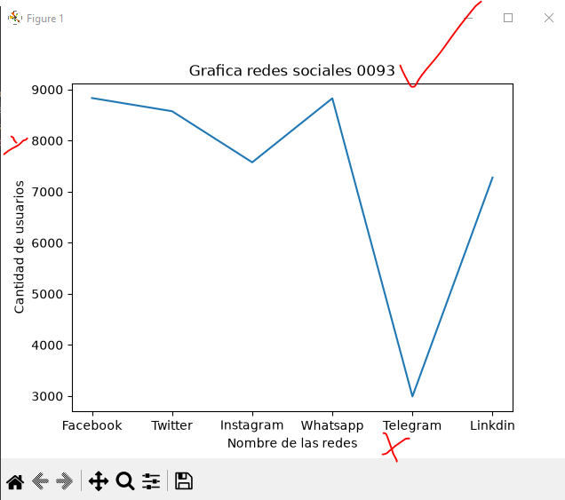
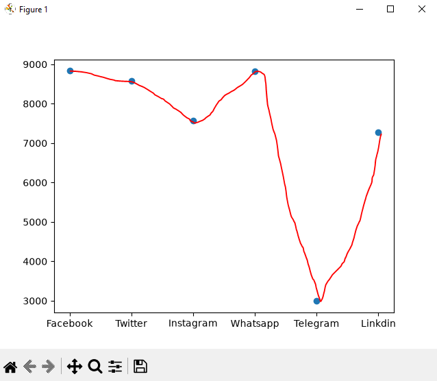
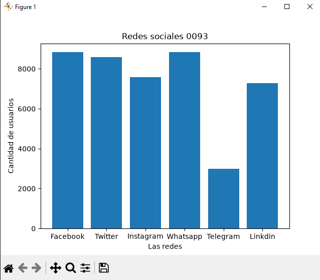
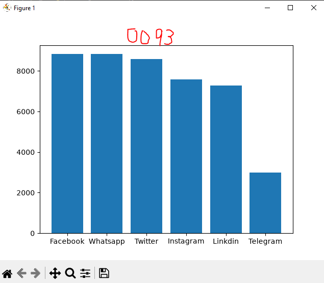
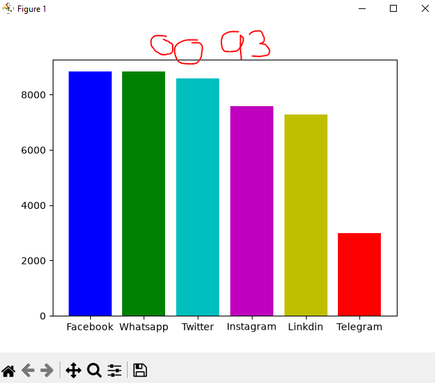
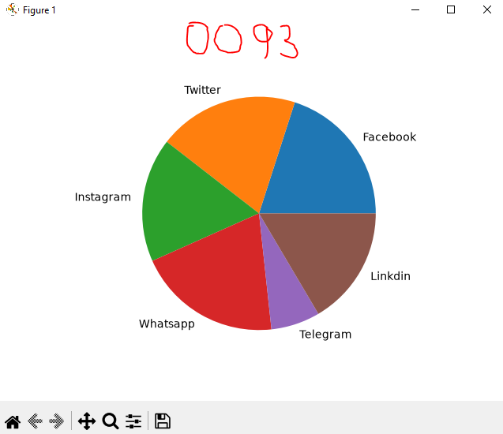

## DataFrame o Marco de datos

## Redes Sociales a nivel mundial

## Grafica lineal de las redes Sociales

## Grafica de puntos de redes sociales

## Grafica de barras de redes sociales

## Grafica de barras de el mas grande al mas chico 

## Coloreando la grafica

## grafica de pastel o pie
